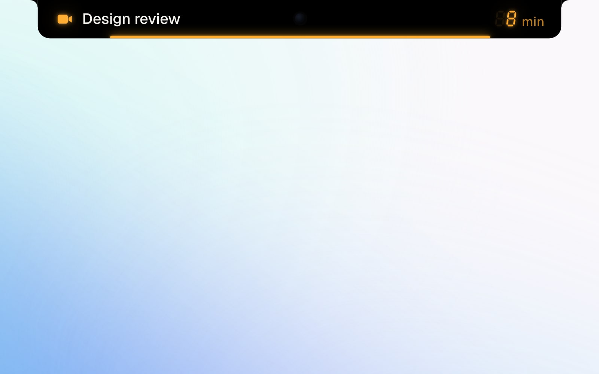
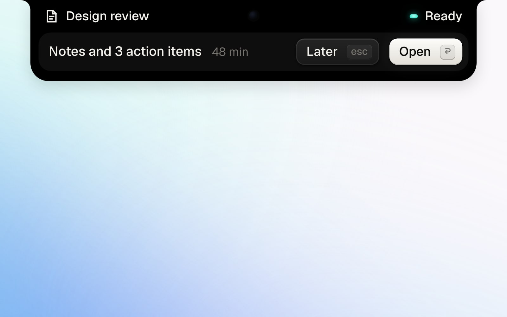
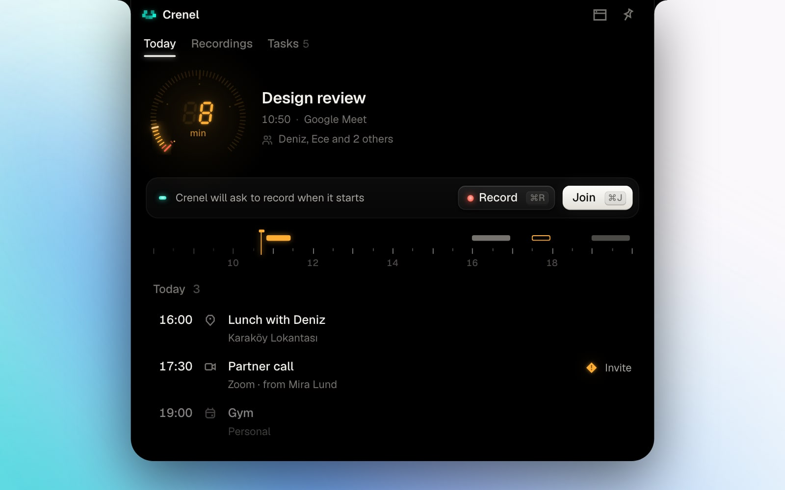
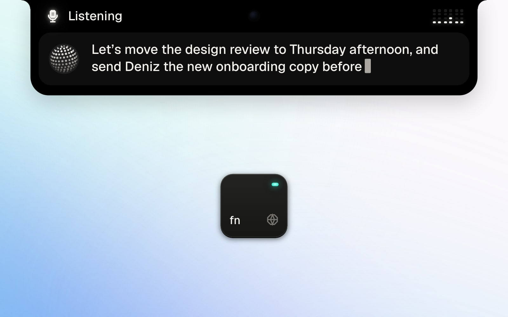
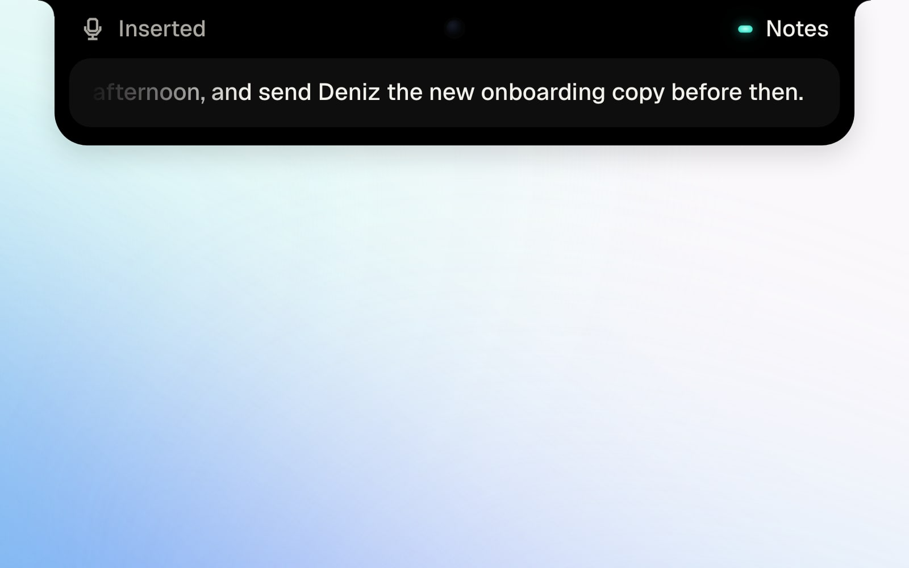
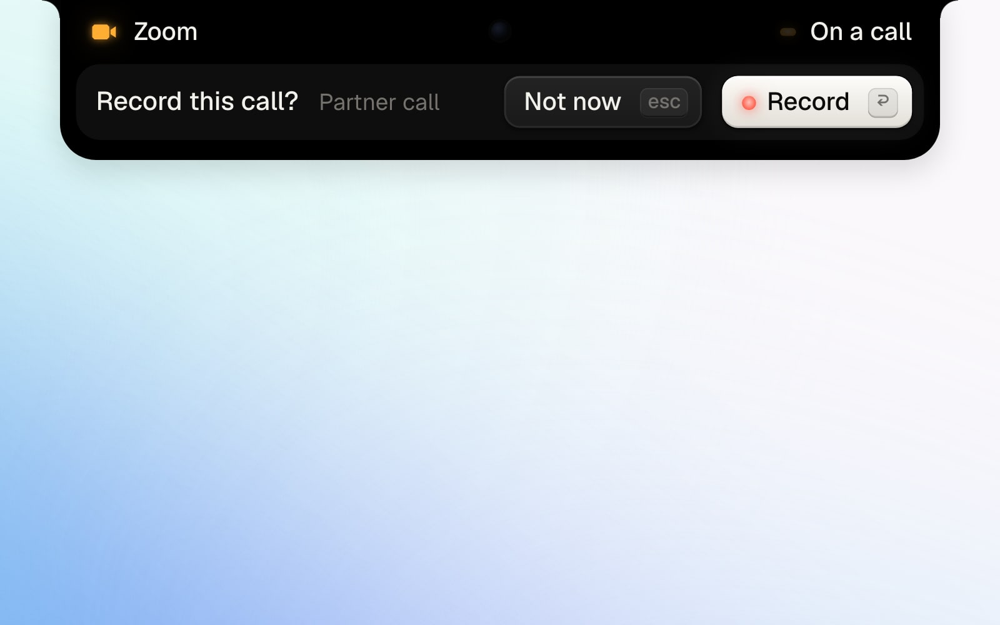
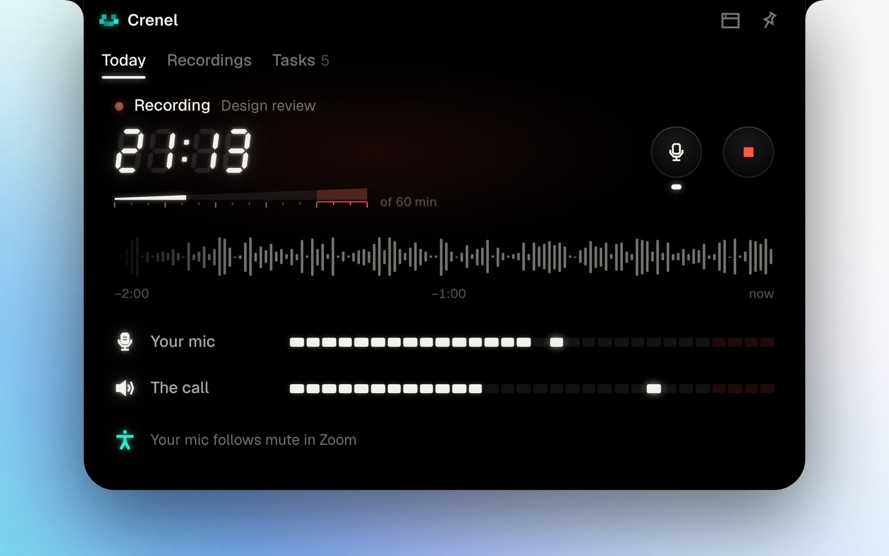
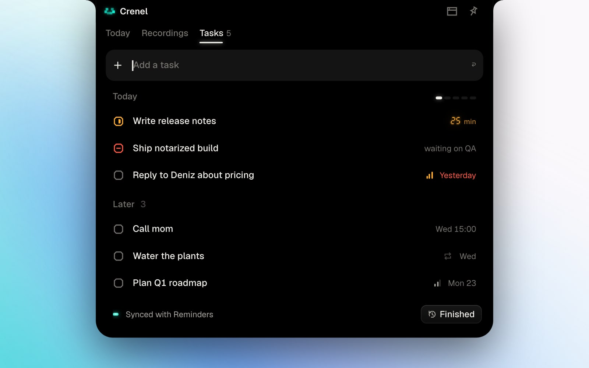
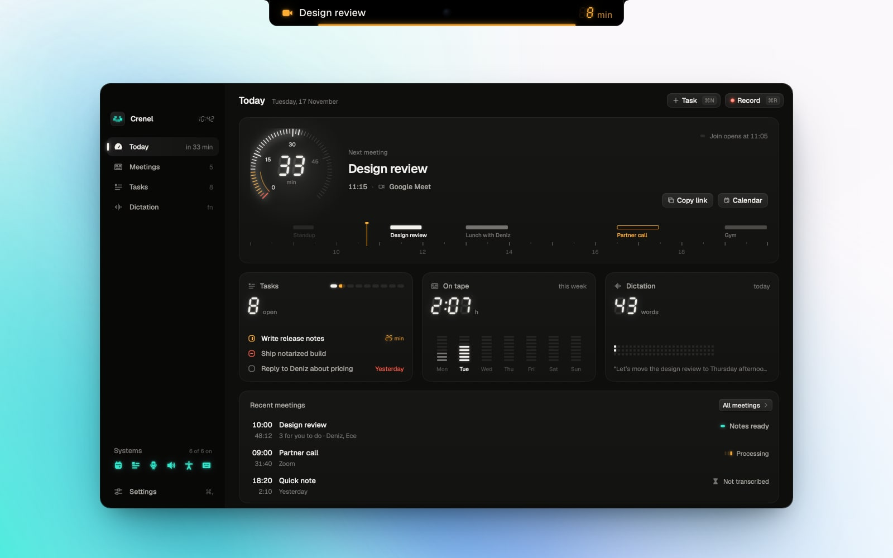

<div align="center">


# Crenel

**Your Mac's notch, at work.**

Calendar, dictation, tasks and meeting notes, right beside the camera.
Open source. Your data stays on your Mac.

[**Download for macOS**](https://github.com/ayhangad/Crenel/releases/latest) · [Watch the video](docs/media/crenel-promo.mp4) · [How it's built](docs/DEVELOPMENT.md)

<sub>macOS 26 or later · Apple silicon and Intel · signed and notarized by Apple</sub>

</div>

---

## What it does

The notch has three sizes. Closed, it shows one thing on each side of the camera: the
next meeting and how long until it starts. When something needs you, a single line drops
under it. Hover, and it opens into a panel.

<p align="center">
  
</p>

<p align="center">
  
</p>

### Calendar

Your next event and the time to it, or how long is left in the one you're in. Calls get a
**Join** key when they start, and invites still waiting for your answer are marked. Crenel
reads Apple Calendar, so iCloud, Google and Exchange accounts all work.

<p align="center">
  
</p>

### Dictation

Hold **fn** and talk. The words go wherever your cursor is. Speech is turned into text on
your Mac and the audio is never saved. Long dictation grows into a live view, and **Undo**
takes it back. Say "add task…" and it becomes a task instead.

<p align="center">
  
</p>

<p align="center">
  
</p>

### Meeting notes

When a Zoom or Google Meet call starts, Crenel asks once whether to record it. It records
only the call and your mic while you're unmuted. Afterwards you get a transcript with
speakers, a summary, what was decided, and what's on you. Export it as Markdown, PDF or
plain text.

<p align="center">
  
</p>

<p align="center">
  
</p>

### Tasks

Type one line: "call mom tomorrow 3pm", "every Monday", "urgent". Crenel understands it as
you write. Tasks live in a **Crenel** list in Apple Reminders, so they follow you to your
iPhone and Watch.

<p align="center">
  
</p>

### And a window when you want one

Everything in the notch also opens in a full desktop window: your day at a glance, every
meeting, tasks, dictation history and settings.

<p align="center">
  
</p>

## Private by design

- **On your Mac.** Recordings, transcripts, notes and tasks are stored locally. Dictation
  runs on Apple's on-device speech model and never saves audio.
- **Your keys, your choice.** Notes and dictation clean-up run on Apple's on-device model,
  your own OpenAI or Anthropic key, or the Claude Code or Codex you already use. Meetings are
  transcribed on your Mac with Apple Speech, or by ElevenLabs with your key. Keys live in your
  Keychain.
- **No account, no analytics.** There is nothing to sign up for and no tracking SDK.
- **Open source.** Every line is in this repository, under the MIT license.

## Install

1. Download **Crenel.dmg** from the [latest release](https://github.com/ayhangad/Crenel/releases/latest).
2. Drag Crenel to Applications and open it.
3. One setup screen lists every permission and what it's for. **Turn on all** walks you
   through them.

Crenel updates itself. Updates wait until you're not on a call.

| Permission | Why | Without it |
|---|---|---|
| Calendar | Show events and the countdown | No calendar |
| Reminders | Keep tasks in sync | Tasks stay on this Mac |
| Microphone | Dictation and recording | No dictation or recording |
| Input Monitoring | Listen for the fn key | No dictation shortcut |
| Accessibility | Type at your cursor, read the call's mute state | Dictation goes to the clipboard |
| Audio capture | Record the call's sound | Only your mic is recorded |

## Build from source

You need macOS 26, a current Xcode and [XcodeGen](https://github.com/yonaskolb/XcodeGen).

```sh
brew install xcodegen
cd macos
xcodegen generate
open Crenel.xcodeproj
```

`macos/project.yml` is the single source of the Xcode project. The full developer guide
(architecture, storage, the processing queue, tests and the release pipeline) is in
[docs/DEVELOPMENT.md](docs/DEVELOPMENT.md) and [ARCHITECTURE.md](ARCHITECTURE.md).

The repository is a monorepo:

| Folder | What's inside |
|---|---|
| `macos/` | The Mac app: project, sources, tests, scripts |
| `browser-extension/` | Chrome extension that brings Google Meet audio to Crenel |
| `docs/` | Design language, the clickable prototype, release notes |
| `promo/` | The Remotion source of the video above |
| `website/` | The Astro site, with the release timeline built from `docs/releases` |

## Contributing

Issues and pull requests are welcome. Start with [CONTRIBUTING.md](CONTRIBUTING.md).

## License

[MIT](LICENSE)
